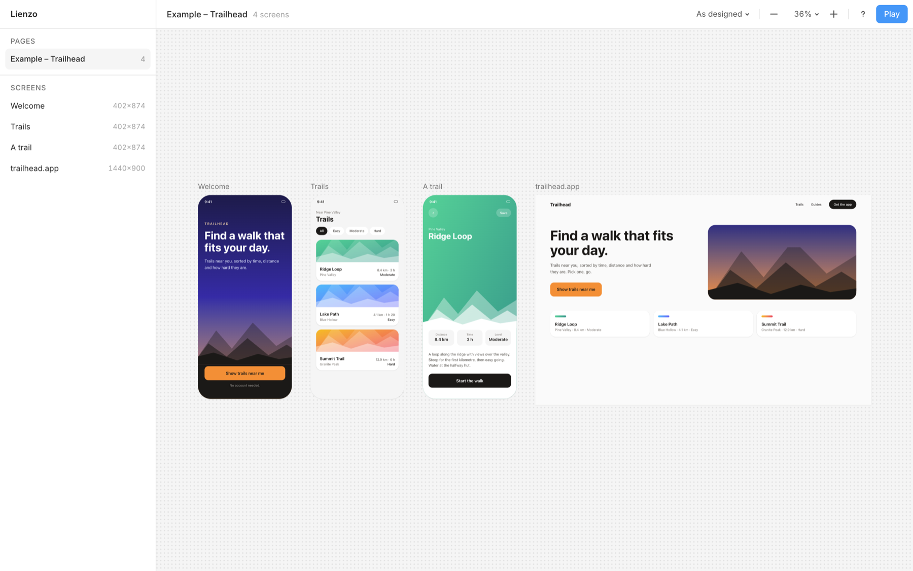

# Lienzo

**A design canvas you talk to.** Describe a screen to your coding agent. It writes the screen as a small React file, and Lienzo shows it on an infinite canvas next to the rest of the flow. Zoom, pan, and press Play to click through it like a prototype.



Lienzo is a very small Figma with no editing tools. There are no colour pickers, no font menus and no frames to drag. Every change is a prompt, and every design is a file you can read, diff and review. *Lienzo* is Spanish for "canvas".

## Why

Coding agents write good UI code fast, but you usually only see one screen at a time, in a running app, after a build. Lienzo lets you design the whole flow first:

1. **Talk.** "Add a sign-in screen after Welcome, with Apple and Google buttons."
2. **The agent writes files.** One `.tsx` file per screen under `designs/`, styled with Tailwind.
3. **Look.** The canvas hot-reloads. Every screen of the page is side by side.
4. **Point.** Hold ⌥ and click a button to copy an exact reference to it, add a note, and paste it in the chat.
5. **Repeat** until it feels right, then build the real thing with the designs next to you.

It works with any agent that can edit files: Claude Code, Codex, Cursor, and others. [`AGENTS.md`](AGENTS.md) tells the agent how.

## Quick start

You need [Bun](https://bun.sh).

```bash
git clone https://github.com/JorgeMenaDev/lienzo.git
cd lienzo
bun install
bun run dev        # http://localhost:3000
```

The example page, *Trailhead*, opens first. Then open your agent in the same folder and ask for a design:

> Make a new page called onboarding with three iPhone screens: a welcome screen, a screen that asks for notifications, and a home screen. Link them with Go buttons.

## Features

- **Pages of screens.** A page is a folder and a screen is a file. The sidebar lists both.
- **Infinite canvas.** Drag or scroll to pan. Pinch or ⌘/Ctrl + scroll to zoom at the pointer. `Shift+1` fits every screen.
- **Play.** Press `P` (or double-click a screen) to use it full size. `<Go to="page/screen">` buttons move between screens, and screens keep their own React state, so tabs, toggles and sheets work.
- **Point at it.** Hold ⌥ to outline the element under the pointer. ⌥-click asks for a note and copies a line like this to paste to your agent:

  ```
  example/trails (designs/example/trails.tsx) · button "Ridge Loop Pine Valley 8.4 km · 3 h Moderate" · 354×176 at (24, 192) · http://localhost:3000/example?screen=trails&pin=120,260 · note: make this card shorter
  ```

  The agent finds the file and the line from the quoted text. The link opens the screen with a marker at the spot.
- **Devices.** Each screen has a size: `iphone` (402×874), `android` (412×917), `desktop` (1440×900), or any `{ width, height }`. The Device menu (`D`) shows the whole page as iPhone, Android or desktop, so a responsive design can be checked at every size.
- **Shareable views.** The URL holds the page, the selected screen, Play, the device and the pin.
- **A design check.** `bun run lienzo check` fails when a `Go` points at a screen that doesn't exist, a size is wrong, or an id is used twice.

Press `?` in the app for every keyboard shortcut.

## A screen file

```tsx
// designs/onboarding/welcome.tsx
import { Go } from "@/lienzo/go";
import type { ScreenMeta } from "@/lienzo/screens";

export const meta = { name: "Welcome", size: "iphone", order: 1 } satisfies ScreenMeta;

export default function Welcome() {
  return (
    <div className="flex h-full flex-col justify-end gap-4 bg-indigo-600 p-8 text-white">
      <h1 className="text-4xl font-bold">Hello.</h1>
      <Go to="onboarding/notifications" className="rounded-2xl bg-white py-4 font-semibold text-indigo-600">
        Get started
      </Go>
    </div>
  );
}
```

The full guide for writing designs, which your agent reads too, is [`designs/README.md`](designs/README.md).

## The CLI

Agents use the CLI to find their way around:

```bash
bun run lienzo list                          # every page and screen, with its URL
bun run lienzo new <page> <screen> --size iphone   # start a screen from the template
bun run lienzo check                         # the design check
bun run lienzo ref <page>/<screen> <x> <y>   # a reference to one point of a screen
```

## Keep your designs private

Lienzo is open source, but your designs don't have to be. Keep them in a private copy that still gets Lienzo's updates:

```bash
# Create an empty private repository called my-designs on GitHub, then:
git clone https://github.com/JorgeMenaDev/lienzo.git my-designs
cd my-designs
git remote rename origin upstream
git remote add origin https://github.com/<you>/my-designs.git
git push -u origin main

# Later, to get Lienzo's updates:
git pull upstream main
```

Add your pages under `designs/` and commit them as usual. You can delete `designs/example/` once you have your own.

## How it works

Lienzo is a Next.js app. `import.meta.glob` finds every file under `designs/`, so a new screen appears without a restart and every edit hot-reloads. Each screen renders inside a frame of its own size, and every frame is a CSS container, so container queries (`@3xl:`) respond to the frame, not the browser window. The canvas uses [UI SDK](https://ui-sdk.dev)'s viewport for pan and zoom, and on the canvas each screen is a picture (`inert`) until you press Play.

Stack: Bun, Next.js, React, TypeScript, Tailwind CSS v4 and UI SDK. There is no backend, no account and no network call: everything runs on your machine.

## Contributing

Issues and pull requests are welcome. Run `bun run ci:gate` (lint, typecheck, design check, tests and build) before you push, and put a screenshot of the canvas in a PR that changes it. [`AGENTS.md`](AGENTS.md) has the conventions.

## License

[MIT](LICENSE)
